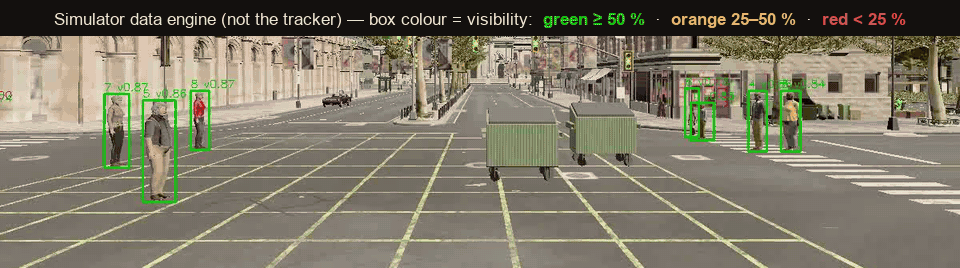
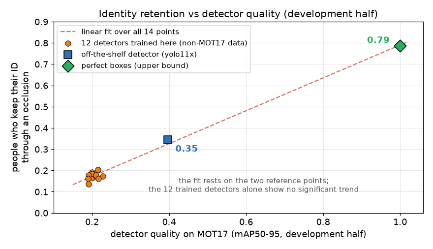

# occlusion-mot

**A people tracker that tries to keep each person's ID when they walk behind someone else — and an honest
measurement of what actually limits it.** Built on MOT17, with a CARLA simulator engine that labels occlusion
automatically.

<a href="demo/s5_carla.mp4"></a>

The project's **simulator data engine** labels every walker's exact visibility for free (12 s excerpt; click to
download the full 20 s mp4). The tracker itself was evaluated on MOT17 video, which is not redistributed here.

- **What it does:** a multi-object tracker (ByteTrack, re-implemented) plus a *hidden-state* module that
  keeps predicting a person's position while they are occluded and re-identifies them when they reappear.
- **Result:** **17 % fewer ID switches at no cost to accuracy** on held-out data.
- **Finding:** the **detector**, not the tracker, is the bottleneck — with perfect boxes, the share of people who keep
  their ID through an occlusion more than doubles (35 % → 79 %). No detector trained here got there.
- **How:** frozen, cached detections so only the tracker varies; every big experiment pre-registered before it ran;
  35 runs on H200 GPUs (TUKE's PERUN university cluster), 18.5 of a fixed 40 GPU-hour budget.

<sub>PyTorch · YOLO11 · Kalman filter / ByteTrack from scratch · ResNet-18 re-ID · CARLA · SLURM on H200 · pre-registered experiments</sub>

**Links:** [one-page plain-English summary](occlusion_mot_plain.md) · [full report](report/omot_report.md) ·
[held-out results](results/val/val_report.md) · [guided demo tour](demo/README.md)

**Terms.** *ID switch*: the tracker gives a person a new number. *Retention*: share of occlusions after which the
person still has the same ID. *HOTA / IDF1*: standard 0–100 tracking scores, higher is better. *mAP*: standard
0–1 detector accuracy. *Re-ID*: an appearance model that tells whether two boxes show the same person.
*Development / held-out half*: MOT17's training videos split in two; everything was tuned on the first half and
checked once on the second.

## The problem

When a person walks behind another person, a tracker usually loses them, and when they reappear it gives them a
**new ID**. On MOT17, ByteTrack keeps the right ID through only **29 %** of occlusions (168 occlusion segments,
development half, [source](results/hidden_dev_audit_base.json)). Counting, flow measurement, or following one
person all break when IDs reset.

## Results

All numbers are on the **held-out half** of MOT17 train (never used for tuning) unless marked *dev*. Held-out
numbers come from one run: the tracker and the cached detections are deterministic, so there is no seed spread.

| question | result | source |
|---|---|---|
| Does the module cost tracking quality? | **No** — HOTA 49.98 → 51.07, IDF1 58.28 → 60.09, ID switches 359 → 298 | [held-out report](results/val/val_report.md) |
| Does it keep more IDs through occlusions? | Slightly — 26.3 % → 27.8 % (*dev*: 29.2 % → 34.5 %) | [held-out report](results/val/val_report.md) |
| Does a bigger re-ID model help? | **No** — no significant tracker gain (best p = 0.143, 3 seeds) | [sweep results](results/sweep/perun_full/) |
| What if the detector were perfect? | Retention 34.5 % → **78.6 %** (*dev*) | [perfect-box result](results/hidden_dev_stage0_gtvis.json) |
| Does detector quality drive it? | **Probably** — retention rises with it across 14 detection sources (*dev*), but the trend rests on two reference points | [summary](results/sweep/perun_detector/summary.json) |
| Did detectors trained here beat the stock one? | **No** — all 12 were worse (*dev* mAP 0.19–0.23 vs 0.40) | [summary](results/sweep/perun_detector/summary.json) |

<p align="center"></p>
<p align="center"><sub>Development half. The 12 detectors trained on non-MOT17 data (to keep the test honest) all landed
<i>below</i> the off-the-shelf one. Fit over all 14 points: slope 0.77, R² 0.99 (for the recoverable-occlusion
ceiling: slope 0.90, 95 % CI 0.78–1.02). The 12 trained detectors span only 0.04 of the x-axis; across them alone the
slope is not significant (0.44, CI −0.38 to 1.26). Figure: <code>python scripts/plot_readme_detector.py</code>.</sub></p>

**Bottom line:** the tracker side works and costs nothing; the remaining gain sits in detection, and the obvious
fix — a detector trained on MOT17-like data — conflicts with the data separation that made this measurement
trustworthy. The project is closed; that is the open problem it leaves.

## How it works

1. **Detect once.** yolo11x detections are cached; every tracker comparison reads the identical cache.
2. **Track.** ByteTrack re-implemented from scratch (Kalman filter + two-stage box matching) and checked against
   the reference implementation: within 0.52 HOTA at identical settings ([check](results/g0_equivalence/)).
3. **Hold hidden people.** When a track is lost behind someone, the module keeps it alive for up to 90 frames
   with a damped motion prediction instead of deleting it.
4. **Re-identify.** When a detection reappears near the prediction, an appearance embedding (ResNet-18 re-ID model)
   decides whether it is the same person.
5. **Measure per occlusion.** Occlusion segments are extracted from ground-truth visibility, and every failure is
   split into "detector never saw them" vs "tracker mismatched them".

## Quickstart

Python 3.11 and [uv](https://docs.astral.sh/uv/). The test suite and the synthetic demo need no dataset and run on
CPU (developed on Windows 11 + RTX 4060 8 GB).

```bash
git clone https://github.com/matus012/occlusion_mot && cd occlusion_mot
uv venv --python 3.11 .venv
uv pip install --python .venv -r requirements.txt -e . \
    --extra-index-url https://download.pytorch.org/whl/cu126 --index-strategy unsafe-best-match
uv run --no-sync python -m pytest -q                                   # licence and data-separation guards included
uv run --no-sync python scripts/demo_synthetic.py --render demo.mp4   # prints HOTA/IDF1 for a synthetic scene, writes demo.mp4
```

`requirements.txt` pins every package (`==`); the extra index is where the CUDA build of PyTorch (~2.5 GB) lives.
On Windows PowerShell, put the install command on one line. Without MOT17 on disk, 292 tests pass and the 2 in
`tests/test_hpc_bundle.py` fail (they check the cluster bundle's data paths).

<details>
<summary>Reproducing the MOT17 numbers</summary>

MOT17 (and, for the re-ID model, MOT20 and Market-1501) are not redistributed; download them under their own
licences ([motchallenge.net](https://motchallenge.net/)). A GPU is needed for detection caching and re-ID training
(an 8 GB RTX 4060 was enough). The pipeline, in order — each script has `--help`; prefix each with
`uv run --no-sync`:

```bash
python scripts/download_mot17_hf.py            # or download_mot17.ps1
python scripts/verify_mot17.py
python scripts/cache_detections.py             # yolo11x detections, once (GPU)
python scripts/extract_occlusion_segments.py   # occlusion segments from ground-truth visibility
python scripts/run_baseline.py                 # ByteTrack baseline
python scripts/download_reid_sources.py        # re-ID training data
python scripts/extract_reid_dataset.py         # + extract_reid_mot20.py, index_market1501.py
python scripts/train_reid.py                   # the appearance model (GPU)
python scripts/cache_embeddings.py             # embeddings for every cached detection
python scripts/run_hidden.py --half dev        # the hidden-state module (--half val for held-out)
python scripts/check_gates.py                  # every pass/fail check, from the result JSONs
```

No trained weights are released (non-commercial training data). Cluster runs: [`HPC_RUNBOOK.md`](HPC_RUNBOOK.md);
pinned Linux/cluster environment: [`requirements-lock.txt`](requirements-lock.txt).
</details>

## Repo layout

```
src/omot/        loaders, detection/embedding caches, tracker, hidden-state module, evaluation
tests/           unit tests incl. licence and train/eval data-separation guards
scripts/         data, caching, training, sweep and plotting entry points
results/         metric JSONs behind every number (no dataset content)
report/          the full write-up
configs/, slurm/ sweep configs and cluster job templates
demo/, viz/      CARLA clip, figures, guided tour
gates.yaml, val_manifest.md, perun_*.md   pass/fail criteria and experiment plans, frozen before the runs
```

## Limitations

- **The held-out gain in retention is small** (0.263 → 0.278), and a target set before the run — retention
  among occlusions the tracker could in principle recover ≥ 0.58 — was missed on held-out data (0.440); see
  [`val_report.md`](results/val/val_report.md).
- **The perfect-detector numbers are an upper bound** measured on the development half, and even with perfect boxes
  ~19 % of recoverable occlusions are still lost inside the tracker.
- **Sim + real training data did not measurably beat real-only** by the rule set before the run.
- **No trained weights are released** (MOT17/MOT20 are non-commercial), so the trained embedder must be retrained.
- Code comments and the report cite decision numbers (D1–D67) from a development log that is not published.

## Licence and credits

**AGPL-3.0-only** ([LICENSE](LICENSE)), because the direct dependency
[Ultralytics](https://github.com/ultralytics/ultralytics) is AGPL-3.0. Datasets — MOT17, MOT20, Market-1501,
CrowdHuman — are used under their non-commercial research licences and are not redistributed; CARLA 0.9.15 (MIT code,
CC-BY assets) renders the synthetic scenes. Full list: [THIRD_PARTY.md](THIRD_PARTY.md).

Builds on ByteTrack (Zhang et al., ECCV 2022), TrackEval / HOTA (Luiten et al., IJCV 2021), the MOTChallenge
benchmarks (Milan et al. 2016; Dendorfer et al. 2020), Market-1501 (Zheng et al., ICCV 2015) and CARLA
(Dosovitskiy et al., CoRL 2017). Cluster time: TUKE PERUN.

```bibtex
@software{filo_occlusion_mot_2026,
  author = {Filo, Matus},
  title  = {occlusion-mot: occlusion-aware multi-object tracking and its detector ceiling},
  year   = {2026},
  url    = {https://github.com/matus012/occlusion_mot}
}
```
